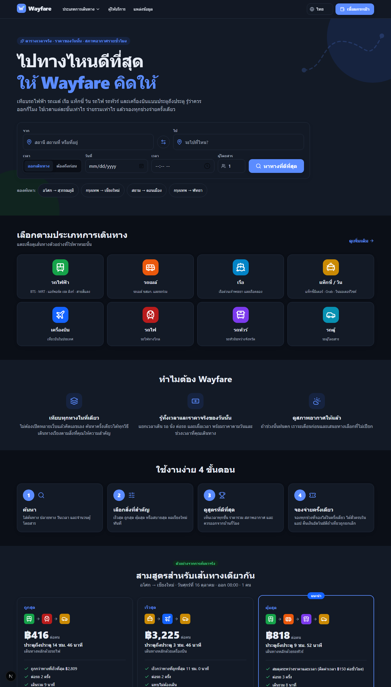
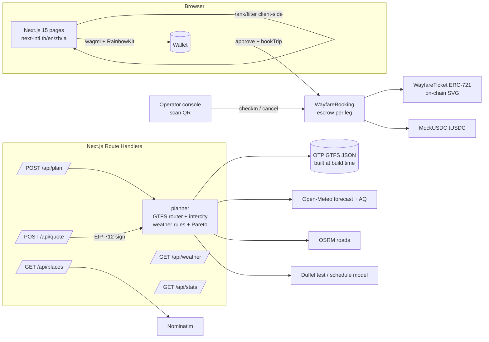
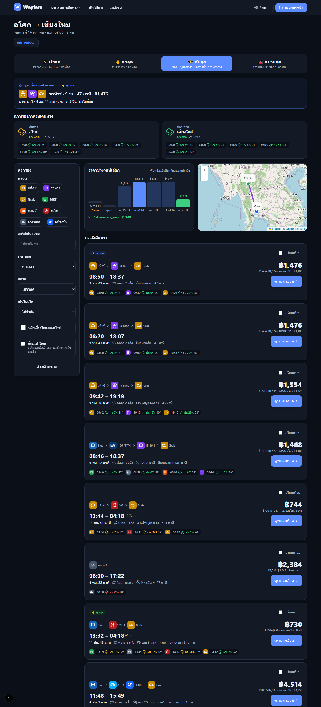
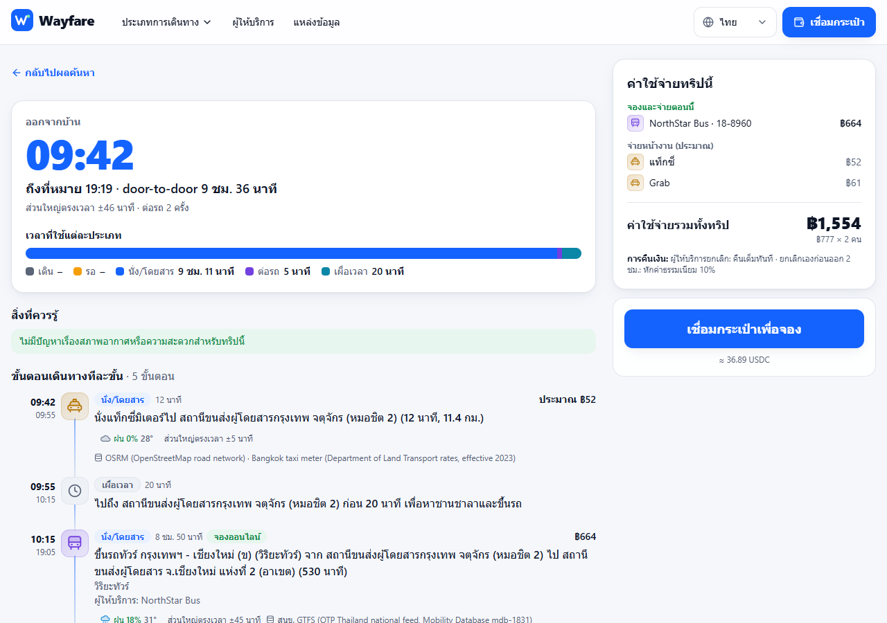
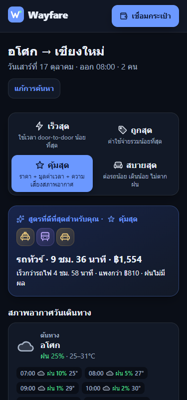

# Wayfare

**Every way to travel, compared in one place. Weather-aware. Booked in one payment on Avalanche.**
**เทียบทุกวิธีเดินทางในที่เดียว ดูสภาพอากาศให้แล้ว จองทุกช่วงจ่ายครั้งเดียวบน Avalanche**

U-Hackathon 2026 · Web3 track



---

## The problem / ปัญหา

**EN** — Planning even a simple trip in Thailand (say Asok → Chiang Mai) means opening 5–6 sites: the BTS/MRT fare table, the SRT timetable, a coach operator, airline sites, a taxi app and a weather app — then doing the maths yourself. Nobody tells you which option is actually best *on that day*, how long each step really takes, when to leave home, or that the cheap motorbike taxi is a bad idea because it will be raining at 17:00.

**TH** — แค่จะเดินทางจากอโศกไปเชียงใหม่ ต้องเปิดเว็บแยกกัน 5–6 เว็บ (ตารางค่าโดยสารรถไฟฟ้า ตารางรถไฟ รถทัวร์ สายการบิน แอปเรียกรถ และพยากรณ์อากาศ) แล้วคิดเลขเอง ไม่มีใครบอกว่าทางไหนดีที่สุด *ในวันนั้น* ใช้เวลาจริงกี่นาที ต้องออกจากบ้านกี่โมง หรือเตือนว่าวินที่ถูกที่สุดไม่ควรนั่งเพราะช่วงนั้นฝนตก

## The solution / วิธีแก้

- **One search, every mode** — BTS, MRT, Airport Rail Link, Red Line, buses, boats, trains, coaches, vans, domestic flights, taxi, Grab, motorbike taxi, walking — door to door.
- **Pick what matters**: ⚡ fastest · 💰 cheapest · ⭐ best value (price + your time + weather risk) · 🛋️ most comfortable. Results re-rank instantly on the client.
- **Every minute itemised**: walk · wait · ride · transfer · buffer, with start/end times, reliability (“very punctual” vs “±20 min traffic”) and **“leave home at 13:20”** for arrive-by searches.
- **That day's prices** and the **total trip cost** × passengers, plus a **7-day price chart** (“going on Thursday is ฿420 cheaper”).
- **Weather-aware**: hourly Open-Meteo forecast at each leg's place and time. Rain ≥ 60% → motorbike taxi “not recommended” with a concrete alternative (“take Grab instead, +฿45, stays dry”); storms add airport buffer; PM2.5 and heat warnings for long walks; “leave at 15:30 to avoid the rain”.
- **Book every bookable leg in one transaction** on Avalanche C-Chain: one EIP-712 signed quote, one payment, escrow per leg, an NFT ticket per leg per passenger with a QR code, instant payout to the operator at check-in, **automatic full refund** if the operator cancels.

## Architecture



- `web/src/lib/providers/` — adapters (`TransitProvider`, `FlightProvider`, `RoadProvider`, `WeatherProvider`), each with cache + labelled fallback; every result carries `source` + `updatedAt`.
- `web/src/lib/planner/` — pure TypeScript: time-dependent GTFS router, intercity door-to-door search with buffers, arrive-by mode, weather rules (`weather-rules.ts`, thresholds in `config.ts`), Pareto filter, scoring.
- `contracts/` — `MockUSDC`, `WayfareTicket`, `WayfareBooking` (Solidity 0.8.24, OpenZeppelin v5, Hardhat 2).

## Data sources: real vs estimated / แหล่งข้อมูลจริงและส่วนที่เป็นการประมาณ

| Data | Source | Status |
|---|---|---|
| BTS, MRT, ARL, Red Line, buses, boats, coaches, vans — routes, stops, timetables/frequencies | **OTP (สนข.) national GTFS**, Mobility Database `mdb-1831`, feed 20261014 | **Real** (imported at build time) |
| Metro / bus / boat / coach fares | GTFS `fare_attributes` + `fare_rules` | **Real**; station-count formula only if a fare is missing |
| Long-distance trains | Bangkok departure from GTFS; journey time, class and fare from SRT published timetable | Departure real, rest **estimate** |
| Domestic flights | Duffel API test mode if `DUFFEL_TEST_TOKEN`; else schedule model (`data/flights.json`) with day/holiday/advance/time-of-day factors | **Estimate** without token (badged) |
| Road distance & time | OSRM; fallback straight line × 1.35 | Real when OSRM reachable, else **backup** (badged) |
| Taxi / win / Grab prices | DLT taxi meter, BMA win table, Grab distance+time estimate | Formula real, Grab **estimate** |
| Hourly weather, PM2.5 | **Open-Meteo** Forecast + Air Quality | **Real**; TMD seasonal normals beyond 16 days or offline |
| Places | Curated list + GTFS stations + **Nominatim/OSM** | Real |
| Thai holidays 2026 | Cabinet / BoT holiday calendar | Real |
| Bookable operators | SkyThai Air, NorthStar Bus, Lanna Rail Express, BlueRiver Ferry, EastCoast Van | **Fictional demo operators** |

Details: [`DECISIONS.md`](DECISIONS.md) and the in-app page `/th/about-data`.

## Sponsor technologies

### Avalanche (C-Chain) — the booking and ticketing core
- **What:** every bookable leg (flight, intercity train, coach, van, boat) of a trip is paid in **one transaction** to `WayfareBooking` on Avalanche C-Chain (Fuji testnet). The contract escrows money per leg, mints one ERC-721 ticket per leg per passenger (`WayfareTicket`, on-chain SVG), releases the leg's money to the operator the moment the QR is scanned at check-in, and **refunds the holder automatically** if the operator cancels. Every transaction in the UI links to Snowtrace; the landing page, booking success screen and footer carry a "Built on Avalanche C-Chain" badge.
- **Why:** multi-operator trips today mean several payments, several refund policies and paper or app-specific tickets. A shared escrow contract gives passengers one payment and guaranteed refunds, and gives small operators instant settlement without a payment processor. Avalanche C-Chain offers EVM tooling (Hardhat, viem, wagmi), sub-second finality that makes check-in feel instant at the door, and fees low enough for per-ticket actions.

### ElevenLabs — spoken trip briefings
- **What:** `POST /api/voice` (server-side, `ELEVENLABS_API_KEY` never reaches the browser) turns text into speech with ElevenLabs' multilingual models (`eleven_multilingual_v2`; Thai uses `eleven_v3`, which supports Thai). The trip page has **"ฟังสรุปทริป / Listen to trip summary"**: when to leave home, each step, the total cost and the weather warnings, in the language the user picked (th/en/zh/ja). In the app's *My trips* tab, each **weather-change alert** has a listen button. Identical text is served from a server cache (and a browser cache), requests are length-capped and rate-limited per IP.
- **Why:** travellers read the plan once and then are on the move — walking to the station, carrying bags, in the rain. Hearing "leave at 13:20, rain 70 % at the Mo Chit transfer" is safer and more accessible (low vision, low literacy, tourists in their own language) than reading small text.
- **Graceful fallback:** without a key, or if ElevenLabs fails, the voice buttons are hidden (or show a short note) and everything else works unchanged.

## Smart contracts (Avalanche C-Chain)

| Contract | Purpose |
|---|---|
| `MockUSDC` | `tUSDC`, 6 decimals, `faucet()` 1,000 per address per hour |
| `WayfareTicket` | ERC-721, one ticket per leg per passenger, on-chain JSON + SVG `tokenURI`, transferable only before check-in |
| `WayfareBooking` | operator registry; `bookTrip(Quote, sig)` verifies EIP-712 signature / expiry / replay / operators, pulls the total **once**, escrows per leg, mints all tickets; `checkIn` pays the operator; `cancelByOperator` refunds the holder in full; `cancelByPassenger` refunds minus fee before the deadline; `claimNoShow` after departure + 2 h |

28 Hardhat tests, including the invariant *paid out + refunded = pulled per trip*.

**Fuji addresses:** not deployed yet from this machine (needs a funded key) — run the steps below; `deploy.ts` writes them to `web/src/lib/contracts.generated.ts` and `contracts/deployments/fuji.json`. Explorer: <https://testnet.snowtrace.io>.

## Run locally / วิธีรัน

Requirements: Node 20+ (tested on 24), npm 10+.

```bash
npm install
cp .env.example .env              # local defaults work as-is
npm run import:gtfs               # optional: refresh GTFS (data is committed)
npm run node                      # terminal 1: Hardhat node on :8546
npm run deploy:local              # terminal 2: deploy + seed sample trips
npm run dev                       # terminal 2: http://localhost:3000/th
```

Wallet for local testing (Hardhat public test keys — **never use on a real network**): add network *Hardhat* `http://127.0.0.1:8546`, chain id `31337`, then import

- passenger: `0x4bbbf85ce3377467afe5d46f804f221813b2bb87f24d81f60f1fcdbf7cbf4356` (account #7)
- operator SkyThai Air: `0x5de4111afa1a4b94908f83103eb1f1706367c2e68ca870fc3fb9a804cdab365a` (#2) · NorthStar Bus `0x7c852118294e51e653712a81e05800f419141751be58f605c371e15141b007a6` (#3) · Lanna Rail Express `0x47e179ec197488593b187f80a00eb0da91f1b9d0b13f8733639f19c30a34926a` (#4)

Tests: `npm test` (contracts + web), `npm run lint`, `npm run check:i18n -w web`, `npm run build`.

## Google login + Cloudflare D1

- **Login:** next-auth 4 (Auth.js, App Router) with the Google provider at `/api/auth/[...nextauth]`; `/[locale]/login` has the "Login with Google" button, the navbar shows the account menu. `middleware.ts` guards `/[locale]/app/**` (trips, tickets, profile) and sends guests to `/login?callbackUrl=…`. The guard only turns on when `GOOGLE_CLIENT_ID`, `GOOGLE_CLIENT_SECRET` and `NEXTAUTH_SECRET` are set, so a fresh clone still runs as a guest.
- **Users in Cloudflare D1:** on every successful login the `signIn` event upserts the user into the `users` table (`id, email, name, image, google_id, created_at, last_login_at`) through the D1 **REST API** (`web/src/lib/cloudflare-d1.ts`, because the app runs on Vercel, not Workers). A D1 outage is logged and never blocks sign-in. Create the table once with `npm run d1:migrate` (or `web/cloudflare/schema.sql`).
- **Google Cloud Console:** OAuth client (Web application) with redirect URIs `http://localhost:3000/api/auth/callback/google` and `https://<your-domain>/api/auth/callback/google`.

## Deploy to Fuji + Vercel

```bash
# .env: DEPLOYER_PRIVATE_KEY, QUOTE_SIGNER_PRIVATE_KEY, OPERATOR_MNEMONIC, NEXT_PUBLIC_CHAIN=fuji
npm run deploy:fuji -w contracts      # deploy, register operators, verify, write addresses
npm run seed:fuji -w contracts        # sample trips for live stats
git add web/src/lib/contracts.generated.ts contracts/deployments && git commit -m "chore: Fuji deployment"
# Vercel: Root Directory = web (npm workspaces install from the repo root automatically; web/vercel.json sets function timeouts)
```

Environment variables to set in Vercel → Settings → Environment Variables (Production):

| Variable | Needed for |
|---|---|
| `NEXT_PUBLIC_CHAIN` = `fuji` | chain selection (needs the committed Fuji deployment, otherwise booking is disabled) |
| `QUOTE_SIGNER_PRIVATE_KEY` | signing booking quotes (server only) |
| `GOOGLE_CLIENT_ID`, `GOOGLE_CLIENT_SECRET` | Google login |
| `NEXTAUTH_SECRET` | `openssl rand -base64 32` |
| `NEXTAUTH_URL` | `https://<your-domain>` |
| `CLOUDFLARE_ACCOUNT_ID`, `CLOUDFLARE_D1_DATABASE_ID`, `CLOUDFLARE_API_TOKEN` | storing users in D1 (token needs *Account → D1 → Edit*) |
| `ELEVENLABS_API_KEY` *(optional)* | voice briefings |
| `DUFFEL_TEST_TOKEN`, `OSRM_URL`, `NEXT_PUBLIC_WALLETCONNECT_PROJECT_ID` *(optional)* | live flights, own routing server, mobile wallets |

## Screenshots

| Results | Trip detail | Mobile |
|---|---|---|
|  |  |  |

## Status

Done: all seven phases — real GTFS + Open-Meteo data layer with fallbacks, planner with 4 priorities, itemised times, leave-by time, daily prices and total cost, weather warnings with alternatives, 7-day price chart, comparison mode, map, one-transaction booking with NFT tickets + QR, passenger cancel / transfer, operator QR check-in, cancel-and-refund, no-show claim, Thai/English (Chinese/Japanese machine-assisted, need native review), PWA manifest.
Not done: Fuji deployment (needs keys/AVAX), live Duffel offers (needs token), service worker/offline mode, Lighthouse audit numbers.

License: MIT (code). GTFS data © OTP Thailand; map data © OpenStreetMap contributors; weather by Open-Meteo (CC BY 4.0).
